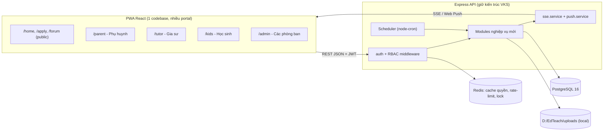
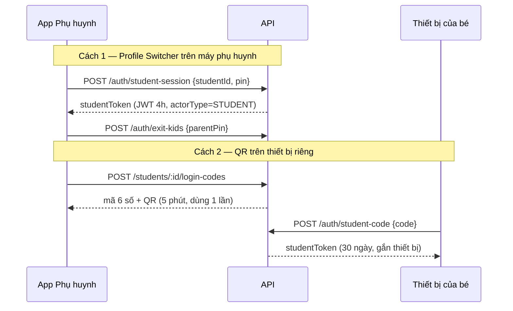
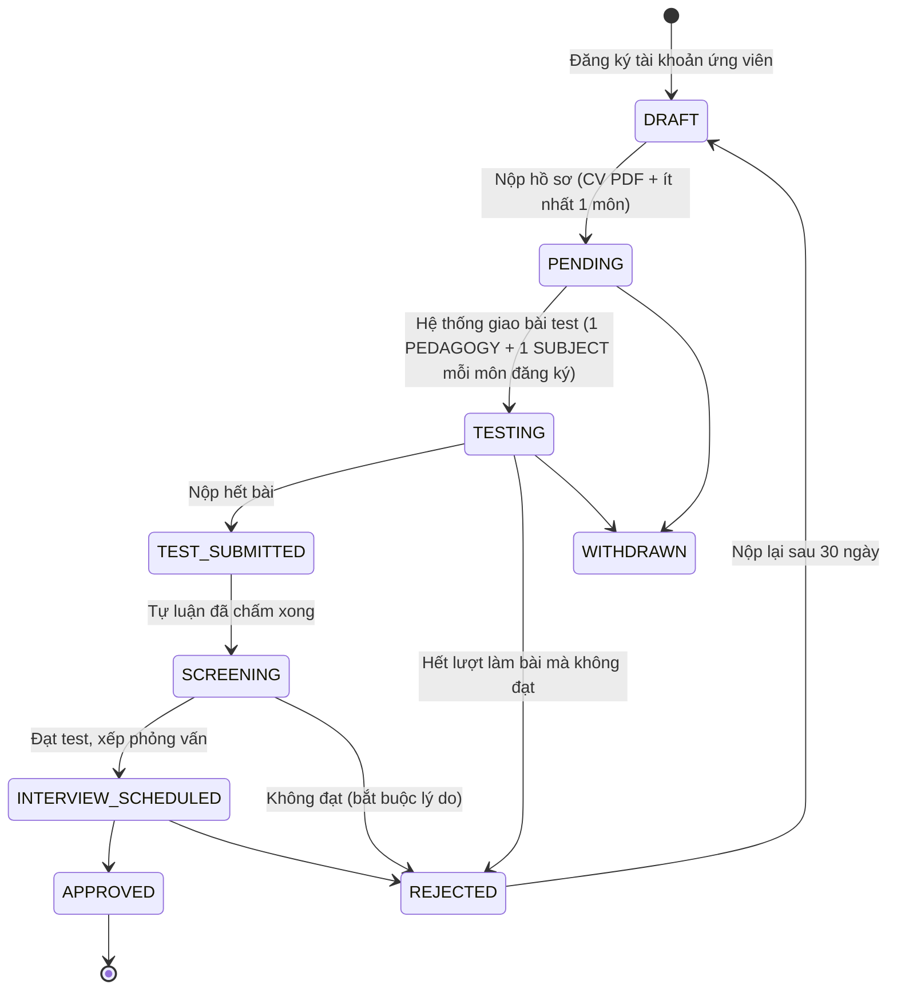
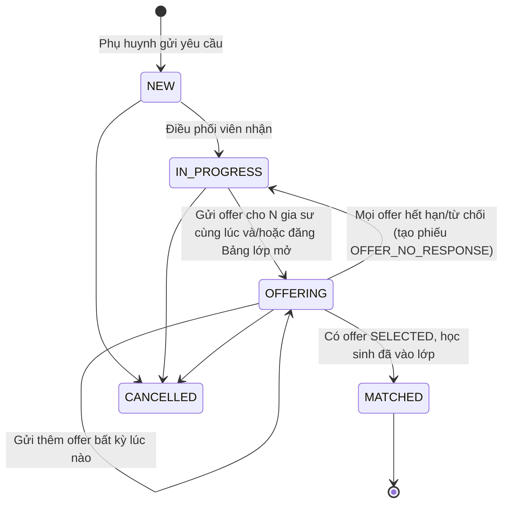
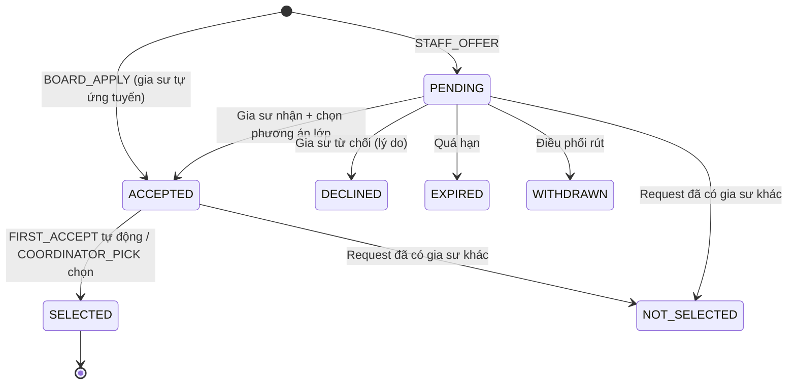
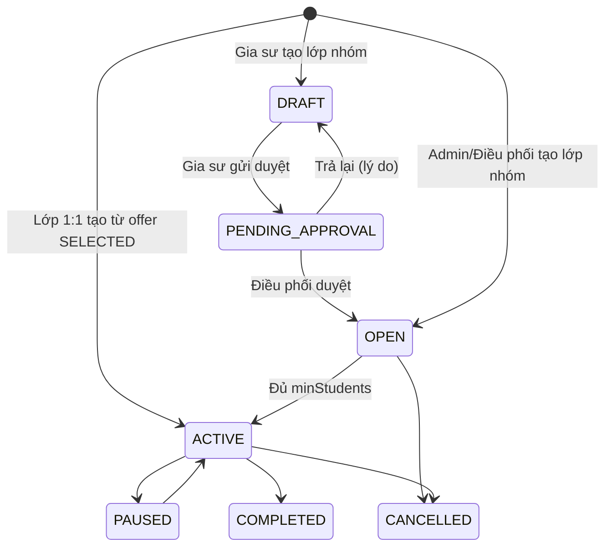
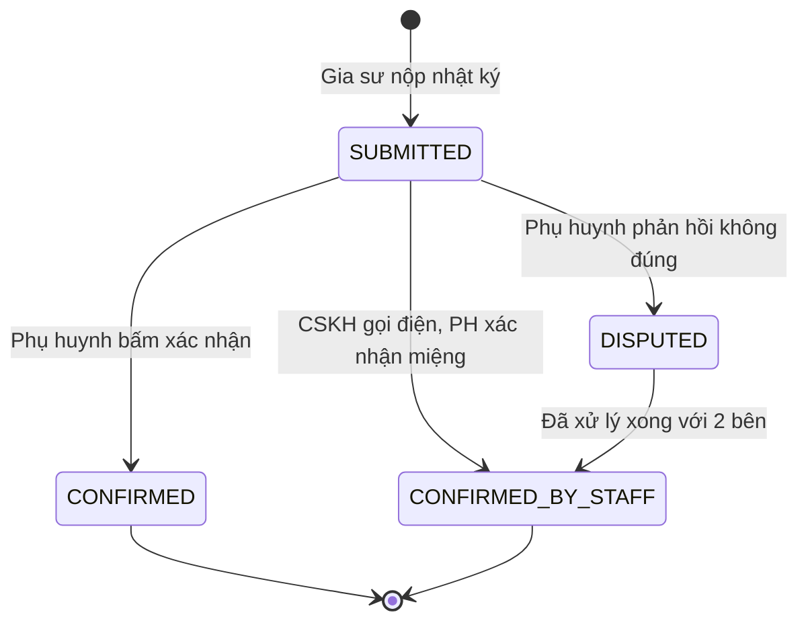
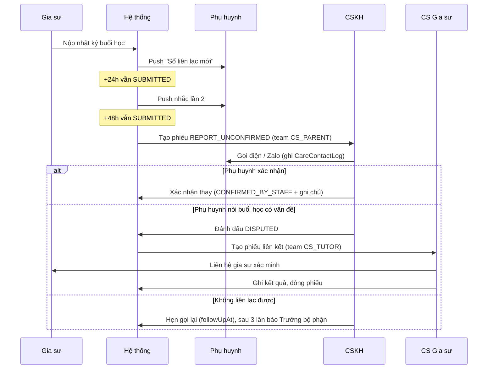
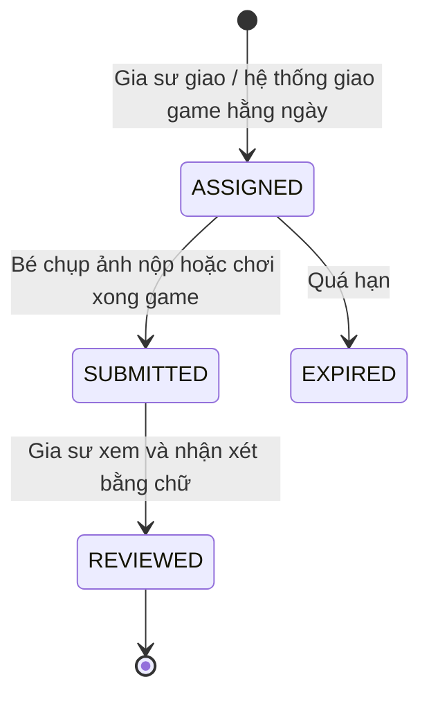

# THIẾT KẾ KỸ THUẬT CHI TIẾT — EdTech Platform (kế thừa VKS-QLCV v3) · **v2**

> Nguồn: `Tai_Lieu_De_Xuat_Chuyen_Doi_EdTech.docx` + dump source `project_BE/FE/ROOT_20261023_141552.txt`.
> Stack giữ nguyên: **Node.js (Express, ESM) + Prisma + PostgreSQL 16 + Redis** · **React + Vite + TS (PWA)** · SSE + Web Push.

## Thay đổi v2 (theo xác nhận của bạn)

| # | Quyết định | Ảnh hưởng thiết kế |
|---|---|---|
| 1 | **Bỏ cơ chế tính sao, chấm điểm** | Xóa `star_transactions`, `starBalance`, mọi trường rating/score của học sinh và buổi học, `tutor_reviews`, `ratingAvg` gia sư. Sổ liên lạc chỉ còn **điểm danh + nhận xét bằng chữ**. Sticker (nếu giữ) mở khóa theo **số nhiệm vụ hoàn thành / chuỗi ngày học**, không dùng sao |
| 2 | **Phụ huynh không bấm xác nhận → nhân sự theo dõi & liên hệ** | Không tự động xác nhận. Thêm 2 đội: **CSKH (phụ huynh)** và **CS Gia sư**. Thêm `care_cases` (phiếu theo dõi) + `care_contact_logs` (nhật ký gọi điện). Nhân sự có thể **xác nhận thay** sau khi gọi điện (`CONFIRMED_BY_STAFF`) |
| 3 | **Gửi offer cho nhiều gia sư song song**, không chờ từng người | `ClassRequest.offerMode`: `FIRST_ACCEPT` (ai nhận trước được) hoặc `COORDINATOR_PICK` (nhận nhiều, điều phối chọn). Có thêm **Bảng lớp mở** để gia sư đủ điều kiện tự ứng tuyển |
| 4 | **Lớp nhiều học sinh**, gia sư và admin đều thiết lập được | `Class.format` = `ONE_ON_ONE` / `GROUP` + `capacity`. Gia sư tự tạo lớp nhóm với lịch cố định (cần điều phối duyệt mở). Khi nhận offer, gia sư chọn: **mở lớp 1:1 mới** hoặc **xếp học sinh vào lớp nhóm có sẵn theo lịch** |
| 5 | **Có bài test online cho ứng viên** | Thêm `assessment_tests`, `assessment_questions`, `assessment_attempts`, `assessment_answers`. Trắc nghiệm chấm tự động, tự luận do Phòng Tuyển dụng chấm. (Chấm điểm ở đây là chấm **ứng viên gia sư**, không phải học sinh) |
| 6 | **Lưu file trong folder dự án** | `UPLOAD_DIR` mặc định `D:\EdTeach\uploads\` (cấu hình qua `.env`), không dùng S3 |

---

## 1. Kiến trúc tổng thể



**Nguyên tắc:**
- Giữ pattern `routes → controllers → services → prisma`; mỗi domain mới là 1 module.
- Phân quyền 2 lớp: `requirePermission()` ở route + **scope filter ở service** (chỉ thấy con mình, lớp mình dạy…).
- Mọi thay đổi trạng thái đi qua `assertTransition(entity, from, to)` và ghi `audit_logs`.

---

## 2. Kế thừa / thay đổi codebase ở mức file

| Thành phần hiện có | Hành động | Ghi chú kỹ thuật |
|---|---|---|
| `middlewares/auth.js` | **Sửa nhẹ** | Hỗ trợ token `actorType=STUDENT` (§4). Cache user+quyền ở Redis 60s |
| `middlewares/permission.js` | **Giữ** | Role Tổng quản trị giữ code `ADMIN` để bypass. **Bỏ trả `userPerms` trong response 403** |
| `config/multer.js` | **Sửa** | Thư mục lưu đổi từ `uploads/{dispatchId}` sang `uploads/{ownerType}/{yyyy}/{mm}/`; thêm `image/webp`, `image/heic`; nén ảnh + xóa EXIF bằng `sharp` |
| `sse.service.js`, `push.service.js`, `notification.helper.js` | **Giữ 100%** | Thêm danh sách event mới (§8) |
| `admin.*`, `departments.*`, `roles.*`, `permissions.*`, `users.*`, `auth.*` | **Giữ** | Seed lại |
| `dispatches.*`, `assignments.*`, `reports.*`, `stats.*` + FE `pvt/ tp/ vt/ chuyende/ Dispatch*`, `googleSheetSync`, `excelService` | **Xóa** | `stats` viết lại |
| `prisma/migrations/*` | **Reset baseline** | Migration mới `0001_edtech_init` |
| `server.js` CORS hard-code `vksqlcv.com`; `docker-compose.yml` hard-code mật khẩu | **Sửa** | Đưa vào `.env` |

### Lưu trữ file (quyết định #6)

```
D:\EdTeach\uploads\
├── tutor-applications\2026\10\   (CV, chứng chỉ, CCCD)
├── lesson-reports\2026\10\       (ảnh bài đã sửa)  + thumbs\
├── tasks\2026\10\                (ảnh bài nộp của học sinh)
├── forum\2026\10\
└── care\2026\10\                 (ghi âm/ảnh minh chứng khi xử lý phiếu)
```
- `.env`: `UPLOAD_DIR=D:/EdTeach/uploads` (mặc định `<repo>/uploads` nếu không khai báo). Thư mục đã nằm trong `.gitignore`.
- File **không** phục vụ qua static; chỉ qua `GET /attachments/:id/preview|download` có kiểm tra quyền theo chủ sở hữu.
- Backup: script `scripts/backup-uploads.ps1` nén thư mục theo ngày (chạy bằng Task Scheduler).

---

## 3. Roles, Departments & Permissions

### 3.1 Phòng ban (5)

| code | Tên | Phụ trách |
|---|---|---|
| `DEPT_RECRUIT` | Tuyển dụng & Thẩm định | Hồ sơ, bài test, phỏng vấn |
| `DEPT_MATCHING` | Điều phối & Ghép lớp | Yêu cầu, offer, lớp học, duyệt lớp nhóm do gia sư tạo |
| `DEPT_CS` | **CSKH (Phụ huynh)** | Theo dõi buổi chưa xác nhận, gọi phụ huynh, khiếu nại |
| `DEPT_TUTOR_CARE` | **CS Gia sư** | Nhắc nộp nhật ký, hỗ trợ/xử lý vấn đề với gia sư |
| `DEPT_ACADEMIC` | Giám sát Học thuật | Chất lượng nội dung, ngân hàng đề test, game, kiểm duyệt diễn đàn |

### 3.2 Roles

| id | code | Tên | Ghi chú |
|---|---|---|---|
| 1 | `ADMIN` | Tổng quản trị | Bypass toàn bộ |
| 2 | `STAFF_RECRUIT` | Chuyên viên Tuyển dụng | |
| 3 | `STAFF_MATCHING` | Điều phối viên | |
| 4 | `STAFF_CS` | CSKH | |
| 5 | `STAFF_TUTOR_CARE` | CS Gia sư | |
| 6 | `STAFF_ACADEMIC` | Học thuật | |
| 7 | `DEPT_MANAGER` | Trưởng bộ phận | Gán kèm role nhân sự; mở scope `department` + thống kê |
| 10 | `APPLICANT` | Ứng viên gia sư | Chỉ hồ sơ + bài test của mình |
| 11 | `TUTOR` | Gia sư | Sau khi APPROVED |
| 12 | `PARENT` | Phụ huynh | |
| 13 | `STUDENT` | Học sinh | Token phạm vi học sinh |

### 3.3 Permission catalog (`module:action[:scope]`)

| Module | Permissions |
|---|---|
| user | `user:view:all` `user:create` `user:update:all` `user:update:own` `user:delete` `user:reset-password` `user:assign-role` |
| catalog | `catalog:manage` |
| tutor_app | `tutor_app:submit` `tutor_app:view:own` `tutor_app:view:all` `tutor_app:review` `tutor_app:decide` |
| assessment | `assessment:take` `assessment:manage` (ngân hàng đề) `assessment:grade` |
| tutor | `tutor:view:all` `tutor:update:own` `tutor:suspend` |
| student | `student:manage:own` `student:view:all` |
| class_request | `class_request:create` `class_request:view:own` `class_request:view:all` `class_request:handle` `class_request:cancel:own` |
| offer | `offer:create` `offer:respond` `offer:select` `offer:view:own` `board:view` `board:apply` |
| class | `class:view:all` `class:view:assigned` `class:view:own` `class:create` `class:create:own` (gia sư tạo lớp nhóm) `class:approve` `class:update` `class:update:own` `class:enroll` `class:close` |
| lesson | `lesson:view:*` `lesson:reschedule` `lesson:cancel` |
| lesson_report | `lesson_report:create` `lesson_report:view:assigned` `lesson_report:view:own` `lesson_report:view:all` `lesson_report:confirm` `lesson_report:confirm:on-behalf` |
| care | `care:view:team` `care:view:all` `care:handle` `care:contact-log` |
| task | `task:create` `task:review` `task:submit` `task:view:own` |
| game | `game:play` `game:manage` |
| forum | `forum:post` `forum:comment` `forum:moderate` |
| stats | `stats:view:all` `stats:view:department` `finance:view` `finance:manage` (GĐ3) |
| admin | `admin:database:view` `admin:audit-logs:view` `admin:settings:manage` |

### 3.4 Ma trận phân quyền (rút gọn)

`own` = dữ liệu của mình/con mình · `asg` = lớp mình dạy · `team` = phiếu của đội mình

| Chức năng | ADMIN | RECRUIT | MATCHING | CS | TUTOR_CARE | ACADEMIC | TUTOR | PARENT | STUDENT |
|---|---|---|---|---|---|---|---|---|---|
| Duyệt hồ sơ, phỏng vấn | ✅ | ✅ | xem | – | xem | xem | own | – | – |
| Quản lý đề test / chấm tự luận | ✅ | ✅ chấm | – | – | – | ✅ đề | – | – | – |
| Làm bài test | – | – | – | – | – | – | – | – | – (APPLICANT) |
| Tạo yêu cầu tìm gia sư | ✅ | – | ✅ | ✅ | – | – | – | own | – |
| Gửi offer song song / chọn gia sư | ✅ | – | ✅ | – | – | – | – | – | – |
| Xem bảng lớp mở & ứng tuyển | – | – | – | – | – | – | ✅ | – | – |
| Nhận / từ chối offer | – | – | – | – | – | – | own | – | – |
| Tạo lớp 1:1 / nhóm | ✅ | – | ✅ | – | – | – | own (nhóm cần duyệt) | – | – |
| Xếp học sinh vào lớp nhóm | ✅ | – | ✅ | – | – | – | asg (từ offer) | – | – |
| Nộp nhật ký buổi học | – | – | – | – | – | – | asg | – | – |
| Xem sổ liên lạc | ✅ | – | ✅ | ✅ | ✅ | ✅ | asg | own | – |
| Xác nhận buổi học | – | – | – | thay PH | – | – | – | own | – |
| Phiếu theo dõi (care case) | ✅ | – | xem | team | team | team | – | – | – |
| Giao bài / nhận xét bài | – | – | – | – | – | – | asg | – | – |
| Làm nhiệm vụ, chơi game | – | – | – | – | – | – | – | xem | own |
| Đăng bài diễn đàn | ✅ | – | – | ✅ | ✅ | ✅ | ✅ | ✅ | – |
| Kiểm duyệt diễn đàn | ✅ | – | – | ✅ | – | ✅ | – | – | – |

---

## 4. Xác thực học sinh (Kids mode)



JWT học sinh: `{ sub: parentUserId, actorType: "STUDENT", studentId, roles: ["STUDENT"] }`. Thoát Kids mode luôn cần PIN phụ huynh. Rate-limit 5 lần/5 phút.

---

## 5. Prisma Schema đầy đủ (v2)

```prisma
generator client {
  provider = "prisma-client-js"
}

datasource db {
  provider = "postgresql"
  url      = env("DATABASE_URL")
}

// ═════════════════════════════════════════════════════════════
// A. CORE (kế thừa VKS-QLCV)
// ═════════════════════════════════════════════════════════════

enum UserType {
  STAFF
  TUTOR
  PARENT
  STUDENT
}

model Department {
  id          String   @id @default(uuid())
  code        String   @unique
  name        String
  managerId   String?  @map("manager_id")
  description String?
  active      Boolean  @default(true)
  order       Int      @default(0)
  createdAt   DateTime @default(now()) @map("created_at")
  updatedAt   DateTime @updatedAt @map("updated_at")

  users User[] @relation("DepartmentUsers")

  @@map("departments")
}

model Role {
  id              Int              @id @default(autoincrement())
  code            String           @unique
  name            String
  description     String?
  level           Int              @default(0)
  isSystem        Boolean          @default(false) @map("is_system")
  active          Boolean          @default(true)
  createdAt       DateTime         @default(now()) @map("created_at")
  updatedAt       DateTime         @updatedAt @map("updated_at")
  userRoles       UserRole[]
  rolePermissions RolePermission[]

  @@map("roles")
}

model Permission {
  id              Int              @id @default(autoincrement())
  code            String           @unique
  name            String
  module          String
  action          String
  scope           String?
  description     String?
  isSystem        Boolean          @default(false) @map("is_system")
  createdAt       DateTime         @default(now()) @map("created_at")
  rolePermissions RolePermission[]

  @@index([module])
  @@map("permissions")
}

model RolePermission {
  id           Int        @id @default(autoincrement())
  roleId       Int        @map("role_id")
  role         Role       @relation(fields: [roleId], references: [id], onDelete: Cascade)
  permissionId Int        @map("permission_id")
  permission   Permission @relation(fields: [permissionId], references: [id], onDelete: Cascade)
  createdAt    DateTime   @default(now()) @map("created_at")

  @@unique([roleId, permissionId])
  @@map("role_permissions")
}

model UserRole {
  id         Int       @id @default(autoincrement())
  userId     String    @map("user_id")
  user       User      @relation(fields: [userId], references: [id], onDelete: Cascade)
  roleId     Int       @map("role_id")
  role       Role      @relation(fields: [roleId], references: [id], onDelete: Cascade)
  assignedBy String?   @map("assigned_by")
  assignedAt DateTime  @default(now()) @map("assigned_at")
  expiresAt  DateTime? @map("expires_at")

  @@unique([userId, roleId])
  @@map("user_roles")
}

model User {
  id            String      @id @default(uuid())
  username      String      @unique
  passwordHash  String      @map("password_hash")
  fullName      String      @map("full_name")
  email         String?     @unique
  phone         String?     @unique
  avatarUrl     String?     @map("avatar_url")
  userType      UserType    @map("user_type")
  position      String?
  departmentId  String?     @map("department_id")
  department    Department? @relation("DepartmentUsers", fields: [departmentId], references: [id])
  parentPinHash String?     @map("parent_pin_hash")

  totpSecret  String?   @map("totp_secret")
  totpEnabled Boolean   @default(false) @map("totp_enabled")
  active      Boolean   @default(true)
  lastLoginAt DateTime? @map("last_login_at")
  lastLoginIp String?   @map("last_login_ip")
  createdAt   DateTime  @default(now()) @map("created_at")
  updatedAt   DateTime  @updatedAt @map("updated_at")
  deletedAt   DateTime? @map("deleted_at")

  userRoles         UserRole[]
  sessions          Session[]
  notifications     Notification[]
  auditLogs         AuditLog[]
  pushSubscriptions PushSubscription[]
  uploads           Attachment[]

  tutorApplication   TutorApplication?   @relation("ApplicantUser")
  reviewedApps       TutorApplication[]  @relation("AppReviewer")
  gradedAttempts     AssessmentAttempt[] @relation("AttemptGrader")
  tutorProfile       TutorProfile?
  parentProfile      ParentProfile?
  studentAccount     StudentProfile?     @relation("StudentAccount")

  handledRequests    ClassRequest[]  @relation("RequestHandler")
  offersSent         ClassOffer[]    @relation("OfferSender")
  classesCreated     Class[]         @relation("ClassCreator")
  coordinatedClasses Class[]         @relation("ClassCoordinator")
  careAssigned       CareCase[]      @relation("CareAssignee")
  careLogs           CareContactLog[]
  tasksCreated       AssignmentTask[]
  forumPosts         ForumPost[]
  forumComments      ForumComment[]
  forumReactions     ForumReaction[]
  forumFlags         ForumFlag[]

  @@index([userType])
  @@index([departmentId])
  @@map("users")
}

model Session {
  id           String    @id @default(uuid())
  userId       String    @map("user_id")
  user         User      @relation(fields: [userId], references: [id], onDelete: Cascade)
  studentId    String?   @map("student_id")
  refreshToken String    @unique @map("refresh_token")
  ipAddress    String?   @map("ip_address")
  userAgent    String?   @map("user_agent")
  deviceType   String?   @map("device_type")
  expiresAt    DateTime  @map("expires_at")
  createdAt    DateTime  @default(now()) @map("created_at")
  revokedAt    DateTime? @map("revoked_at")

  @@index([userId])
  @@map("sessions")
}

model Notification {
  id            String    @id @default(uuid())
  userId        String    @map("user_id")
  user          User      @relation(fields: [userId], references: [id], onDelete: Cascade)
  type          String
  title         String
  content       String?
  referenceType String?   @map("reference_type")
  referenceId   String?   @map("reference_id")
  link          String?
  isRead        Boolean   @default(false) @map("is_read")
  readAt        DateTime? @map("read_at")
  sentViaPush   Boolean   @default(false) @map("sent_via_push")
  createdAt     DateTime  @default(now()) @map("created_at")

  @@index([userId, isRead])
  @@index([createdAt])
  @@map("notifications")
}

model AuditLog {
  id           String   @id @default(uuid())
  userId       String?  @map("user_id")
  user         User?    @relation(fields: [userId], references: [id])
  userName     String?  @map("user_name")
  userRole     String?  @map("user_role")
  action       String
  entityType   String?  @map("entity_type")
  entityId     String?  @map("entity_id")
  oldValue     Json?    @map("old_value")
  newValue     Json?    @map("new_value")
  ipAddress    String?  @map("ip_address")
  userAgent    String?  @map("user_agent")
  method       String?
  endpoint     String?
  status       String   @default("SUCCESS")
  errorMessage String?  @map("error_message")
  createdAt    DateTime @default(now()) @map("created_at")

  @@index([userId])
  @@index([entityType, entityId])
  @@index([createdAt])
  @@map("audit_logs")
}

model SystemSetting {
  key         String   @id
  value       String
  type        String   @default("string")
  category    String   @default("SYSTEM")
  description String?
  updatedAt   DateTime @updatedAt @map("updated_at")

  @@map("system_settings")
}

model PushSubscription {
  id               String   @id @default(uuid())
  userId           String?  @map("user_id")
  user             User?    @relation(fields: [userId], references: [id], onDelete: Cascade)
  isGuest          Boolean  @default(false) @map("is_guest")
  subscriptionType String   @default("ALL") @map("subscription_type")
  endpoint         String   @unique @db.Text
  p256dh           String   @db.Text
  auth             String   @db.Text
  userAgent        String?  @map("user_agent")
  deviceType       String?  @map("device_type")
  createdAt        DateTime @default(now()) @map("created_at")
  lastUsedAt       DateTime @default(now()) @map("last_used_at")

  @@index([userId])
  @@map("push_subscriptions")
}

/// Đúng 1 FK owner khác NULL (CHECK trong migration SQL). File nằm trong UPLOAD_DIR.
model Attachment {
  id         String @id @default(uuid())
  uploaderId String @map("uploader_id")
  uploader   User   @relation(fields: [uploaderId], references: [id])

  tutorApplicationId String?           @map("tutor_application_id")
  tutorApplication   TutorApplication? @relation(fields: [tutorApplicationId], references: [id], onDelete: Cascade)
  assessmentAnswerId String?           @map("assessment_answer_id")
  assessmentAnswer   AssessmentAnswer? @relation(fields: [assessmentAnswerId], references: [id], onDelete: Cascade)
  lessonReportId     String?           @map("lesson_report_id")
  lessonReport       LessonReport?     @relation(fields: [lessonReportId], references: [id], onDelete: Cascade)
  assignmentTaskId   String?           @map("assignment_task_id")
  assignmentTask     AssignmentTask?   @relation(fields: [assignmentTaskId], references: [id], onDelete: Cascade)
  careCaseId         String?           @map("care_case_id")
  careCase           CareCase?         @relation(fields: [careCaseId], references: [id], onDelete: Cascade)
  forumPostId        String?           @map("forum_post_id")
  forumPost          ForumPost?        @relation(fields: [forumPostId], references: [id], onDelete: Cascade)
  forumCommentId     String?           @map("forum_comment_id")
  forumComment       ForumComment?     @relation(fields: [forumCommentId], references: [id], onDelete: Cascade)

  category  String   // CV | CERTIFICATE | ID_CARD | CORRECTED_WORK | HOMEWORK | SUBMISSION | EVIDENCE | IMAGE
  fileName  String   @map("file_name")
  filePath  String   @map("file_path") // đường dẫn tương đối so với UPLOAD_DIR
  thumbPath String?  @map("thumb_path")
  fileSize  Int      @map("file_size")
  mimeType  String   @map("mime_type")
  fileHash  String?  @map("file_hash")
  isDeleted Boolean  @default(false) @map("is_deleted")
  createdAt DateTime @default(now()) @map("created_at")

  @@index([tutorApplicationId])
  @@index([lessonReportId])
  @@index([assignmentTaskId])
  @@index([careCaseId])
  @@index([forumPostId])
  @@map("attachments")
}

// ═════════════════════════════════════════════════════════════
// B. DANH MỤC GIÁO DỤC
// ═════════════════════════════════════════════════════════════

enum UiMode {
  KIDS
  TEEN
  ADULT
}

model EducationLevel {
  id          Int          @id @default(autoincrement())
  code        String       @unique // PRIMARY | LOWER_SEC | UPPER_SEC | UNI_PREP | LANG_CERT
  name        String
  order       Int          @default(0)
  active      Boolean      @default(true)
  gradeLevels GradeLevel[]

  @@map("education_levels")
}

model GradeLevel {
  id               Int            @id @default(autoincrement())
  code             String         @unique // G1..G12 | HSK1..HSK6 | IELTS_F | STARTERS | MOVERS
  name             String
  educationLevelId Int            @map("education_level_id")
  educationLevel   EducationLevel @relation(fields: [educationLevelId], references: [id])
  order            Int            @default(0)
  defaultUiMode    UiMode         @default(KIDS) @map("default_ui_mode")
  active           Boolean        @default(true)

  subjectLevels SubjectLevel[]
  students      StudentProfile[]

  @@map("grade_levels")
}

model SubjectCategory {
  id       Int       @id @default(autoincrement())
  code     String    @unique // STEM | LANGUAGE | SOCIAL | SKILL
  name     String
  order    Int       @default(0)
  subjects Subject[]

  @@map("subject_categories")
}

model Subject {
  id         Int             @id @default(autoincrement())
  code       String          @unique
  name       String
  categoryId Int             @map("category_id")
  category   SubjectCategory @relation(fields: [categoryId], references: [id])
  icon       String?
  color      String?
  active     Boolean         @default(true)

  levels    SubjectLevel[]
  miniGames MiniGame[]

  @@map("subjects")
}

model SubjectLevel {
  id           Int        @id @default(autoincrement())
  subjectId    Int        @map("subject_id")
  subject      Subject    @relation(fields: [subjectId], references: [id])
  gradeLevelId Int        @map("grade_level_id")
  gradeLevel   GradeLevel @relation(fields: [gradeLevelId], references: [id])
  displayName  String?    @map("display_name")
  active       Boolean    @default(true)

  tutorSubjects       TutorSubject[]
  applicationSubjects TutorApplicationSubject[]
  assessmentTests     AssessmentTest[]
  classRequests       ClassRequest[]
  classes             Class[]
  gameContentSets     GameContentSet[]

  @@unique([subjectId, gradeLevelId])
  @@map("subject_levels")
}

// ═════════════════════════════════════════════════════════════
// C. TUYỂN DỤNG, BÀI TEST & HỒ SƠ GIA SƯ
// ═════════════════════════════════════════════════════════════

enum ApplicationStatus {
  DRAFT
  PENDING              // đã nộp, hệ thống giao bài test
  TESTING              // đang làm bài test
  TEST_SUBMITTED       // đã nộp hết bài, chờ chấm tự luận
  SCREENING            // chuyên viên thẩm định hồ sơ + kết quả test
  INTERVIEW_SCHEDULED
  APPROVED
  REJECTED
  WITHDRAWN
}

enum TeachingMode {
  ONLINE
  OFFLINE
  BOTH
}

model TutorApplication {
  id              String            @id @default(uuid())
  code            String            @unique // HS-2026-00012
  userId          String            @unique @map("user_id")
  user            User              @relation("ApplicantUser", fields: [userId], references: [id])
  fullName        String            @map("full_name")
  dob             DateTime?         @db.Date
  gender          String?
  phone           String
  email           String
  province        String?
  district        String?
  occupation      String?
  school          String?
  major           String?
  degree          String?
  experienceYears Int               @default(0) @map("experience_years")
  bio             String?           @db.Text
  introVideoUrl   String?           @map("intro_video_url")
  expectedRate    Decimal?          @map("expected_rate") @db.Decimal(12, 0)
  teachingMode    TeachingMode      @default(BOTH) @map("teaching_mode")
  canTeachGroup   Boolean           @default(false) @map("can_teach_group")
  availability    Json?
  status          ApplicationStatus @default(DRAFT)
  reviewerId      String?           @map("reviewer_id")
  reviewer        User?             @relation("AppReviewer", fields: [reviewerId], references: [id])
  interviewAt     DateTime?         @map("interview_at")
  interviewNote   String?           @map("interview_note") @db.Text
  rejectReason    String?           @map("reject_reason")
  submittedAt     DateTime?         @map("submitted_at")
  decidedAt       DateTime?         @map("decided_at")
  createdAt       DateTime          @default(now()) @map("created_at")
  updatedAt       DateTime          @updatedAt @map("updated_at")

  subjects     TutorApplicationSubject[]
  attempts     AssessmentAttempt[]
  attachments  Attachment[]
  tutorProfile TutorProfile?

  @@index([status])
  @@index([reviewerId])
  @@map("tutor_applications")
}

model TutorApplicationSubject {
  applicationId  String           @map("application_id")
  application    TutorApplication @relation(fields: [applicationId], references: [id], onDelete: Cascade)
  subjectLevelId Int              @map("subject_level_id")
  subjectLevel   SubjectLevel     @relation(fields: [subjectLevelId], references: [id])

  @@id([applicationId, subjectLevelId])
  @@map("tutor_application_subjects")
}

// ---------- Bài test online cho ứng viên ----------

enum TestKind {
  PEDAGOGY   // nghiệp vụ sư phạm chung (bắt buộc mọi ứng viên)
  SUBJECT    // chuyên môn theo môn × khối
}

model AssessmentTest {
  id             String        @id @default(uuid())
  code           String        @unique
  title          String
  kind           TestKind
  subjectLevelId Int?          @map("subject_level_id")
  subjectLevel   SubjectLevel? @relation(fields: [subjectLevelId], references: [id])
  durationMin    Int           @default(30) @map("duration_min")
  questionCount  Int           @default(20) @map("question_count") // rút ngẫu nhiên từ ngân hàng
  passPercent    Int           @default(70) @map("pass_percent")
  maxAttempts    Int           @default(2) @map("max_attempts")
  shuffle        Boolean       @default(true)
  active         Boolean       @default(true)
  createdAt      DateTime      @default(now()) @map("created_at")

  questions AssessmentQuestion[]
  attempts  AssessmentAttempt[]

  @@map("assessment_tests")
}

enum QuestionType {
  SINGLE_CHOICE
  MULTI_CHOICE
  SHORT_TEXT     // so khớp đáp án
  ESSAY          // chấm tay (VD: soạn giáo án ngắn, xử lý tình huống)
}

model AssessmentQuestion {
  id          String         @id @default(uuid())
  testId      String         @map("test_id")
  test        AssessmentTest @relation(fields: [testId], references: [id], onDelete: Cascade)
  type        QuestionType
  content     String         @db.Text
  options     Json?          // [{key:"A", text:"..."}]
  answerKey   Json?          // ["A"] | ["A","C"] | ["đáp án 1","đáp án 2"] — không bao giờ trả về client
  points      Int            @default(1)
  explanation String?        @db.Text
  active      Boolean        @default(true)

  answers AssessmentAnswer[]

  @@index([testId])
  @@map("assessment_questions")
}

enum AttemptStatus {
  IN_PROGRESS
  SUBMITTED       // đã nộp, còn câu tự luận chưa chấm
  GRADED
  EXPIRED         // hết giờ, hệ thống tự nộp
}

model AssessmentAttempt {
  id            String           @id @default(uuid())
  applicationId String           @map("application_id")
  application   TutorApplication @relation(fields: [applicationId], references: [id], onDelete: Cascade)
  testId        String           @map("test_id")
  test          AssessmentTest   @relation(fields: [testId], references: [id])
  attemptNo     Int              @default(1) @map("attempt_no")
  questionIds   Json             @map("question_ids") // đề đã rút cho lượt này
  status        AttemptStatus    @default(IN_PROGRESS)
  startedAt     DateTime         @default(now()) @map("started_at")
  deadlineAt    DateTime         @map("deadline_at")
  submittedAt   DateTime?        @map("submitted_at")
  autoScore     Int?             @map("auto_score")
  manualScore   Int?             @map("manual_score")
  maxScore      Int?             @map("max_score")
  percent       Int?
  passed        Boolean?
  gradedById    String?          @map("graded_by_id")
  gradedBy      User?            @relation("AttemptGrader", fields: [gradedById], references: [id])
  gradedAt      DateTime?        @map("graded_at")
  tabSwitchCount Int             @default(0) @map("tab_switch_count") // chống gian lận cơ bản

  answers AssessmentAnswer[]

  @@unique([applicationId, testId, attemptNo])
  @@map("assessment_attempts")
}

model AssessmentAnswer {
  id           String             @id @default(uuid())
  attemptId    String             @map("attempt_id")
  attempt      AssessmentAttempt  @relation(fields: [attemptId], references: [id], onDelete: Cascade)
  questionId   String             @map("question_id")
  question     AssessmentQuestion @relation(fields: [questionId], references: [id])
  answer       Json?
  isCorrect    Boolean?           @map("is_correct")
  pointsEarned Int?               @map("points_earned")
  graderNote   String?            @map("grader_note")
  attachments  Attachment[]       // ứng viên đính kèm ảnh giáo án cho câu ESSAY

  @@unique([attemptId, questionId])
  @@map("assessment_answers")
}

// ---------- Hồ sơ gia sư chính thức ----------

enum TutorStatus {
  ACTIVE
  PAUSED
  SUSPENDED
}

model TutorProfile {
  id            String            @id @default(uuid())
  userId        String            @unique @map("user_id")
  user          User              @relation(fields: [userId], references: [id])
  applicationId String?           @unique @map("application_id")
  application   TutorApplication? @relation(fields: [applicationId], references: [id])
  headline      String?
  bio           String?           @db.Text
  hourlyRate    Decimal?          @map("hourly_rate") @db.Decimal(12, 0)
  teachingMode  TeachingMode      @default(BOTH) @map("teaching_mode")
  canTeachGroup Boolean           @default(false) @map("can_teach_group")
  province      String?
  district      String?
  maxClasses    Int               @default(5) @map("max_classes")
  status        TutorStatus       @default(ACTIVE)
  verifiedAt    DateTime?         @map("verified_at")
  createdAt     DateTime          @default(now()) @map("created_at")
  updatedAt     DateTime          @updatedAt @map("updated_at")

  subjects     TutorSubject[]
  availability TutorAvailability[]
  offers       ClassOffer[]
  classes      Class[]
  reports      LessonReport[]
  careCases    CareCase[]

  @@index([status, province])
  @@map("tutor_profiles")
}

model TutorSubject {
  tutorId        String       @map("tutor_id")
  tutor          TutorProfile @relation(fields: [tutorId], references: [id], onDelete: Cascade)
  subjectLevelId Int          @map("subject_level_id")
  subjectLevel   SubjectLevel @relation(fields: [subjectLevelId], references: [id])

  @@id([tutorId, subjectLevelId])
  @@index([subjectLevelId])
  @@map("tutor_subjects")
}

model TutorAvailability {
  id        String       @id @default(uuid())
  tutorId   String       @map("tutor_id")
  tutor     TutorProfile @relation(fields: [tutorId], references: [id], onDelete: Cascade)
  weekday   Int
  startTime String       @map("start_time")
  endTime   String       @map("end_time")

  @@index([tutorId, weekday])
  @@map("tutor_availability")
}

// ═════════════════════════════════════════════════════════════
// D. PHỤ HUYNH & HỌC SINH
// ═════════════════════════════════════════════════════════════

model ParentProfile {
  id        String   @id @default(uuid())
  userId    String   @unique @map("user_id")
  user      User     @relation(fields: [userId], references: [id])
  address   String?
  province  String?
  district  String?
  createdAt DateTime @default(now()) @map("created_at")

  children      StudentProfile[]
  classRequests ClassRequest[]
  careCases     CareCase[]

  @@map("parent_profiles")
}

model StudentProfile {
  id             String        @id @default(uuid())
  parentId       String        @map("parent_id")
  parent         ParentProfile @relation(fields: [parentId], references: [id])
  userId         String?       @unique @map("user_id")
  user           User?         @relation("StudentAccount", fields: [userId], references: [id])
  fullName       String        @map("full_name")
  nickname       String?
  dob            DateTime?     @db.Date
  gender         String?
  gradeLevelId   Int           @map("grade_level_id")
  gradeLevel     GradeLevel    @relation(fields: [gradeLevelId], references: [id])
  school         String?
  avatarKey      String?       @map("avatar_key")
  uiMode         UiMode        @default(KIDS) @map("ui_mode")
  pinHash        String?       @map("pin_hash")
  streakDays     Int           @default(0) @map("streak_days")       // chuỗi ngày có làm nhiệm vụ
  tasksCompleted Int           @default(0) @map("tasks_completed")   // bộ đếm để mở sticker
  lastActiveDate DateTime?     @map("last_active_date") @db.Date
  active         Boolean       @default(true)
  createdAt      DateTime      @default(now()) @map("created_at")
  updatedAt      DateTime      @updatedAt @map("updated_at")

  classRequests ClassRequest[]
  enrollments   ClassStudent[]
  reports       LessonReport[]
  tasks         AssignmentTask[]
  gameSessions  GameSession[]
  rewards       StudentReward[]
  loginCodes    StudentLoginCode[]

  @@index([parentId])
  @@map("student_profiles")
}

model StudentLoginCode {
  id        String         @id @default(uuid())
  studentId String         @map("student_id")
  student   StudentProfile @relation(fields: [studentId], references: [id], onDelete: Cascade)
  codeHash  String         @map("code_hash")
  expiresAt DateTime       @map("expires_at")
  usedAt    DateTime?      @map("used_at")
  createdAt DateTime       @default(now()) @map("created_at")

  @@index([studentId])
  @@map("student_login_codes")
}

// ═════════════════════════════════════════════════════════════
// E. YÊU CẦU, OFFER SONG SONG & BẢNG LỚP MỞ
// ═════════════════════════════════════════════════════════════

enum ClassRequestStatus {
  NEW
  IN_PROGRESS   // điều phối viên đã nhận
  OFFERING      // đã có ≥1 offer đang mở / đăng bảng
  MATCHED       // học sinh đã được xếp vào lớp
  CANCELLED
}

enum OfferMode {
  FIRST_ACCEPT       // gửi nhiều gia sư, ai nhận trước được chọn tự động
  COORDINATOR_PICK   // gia sư bấm nhận = ứng tuyển, điều phối viên chọn 1
}

enum ClassFormat {
  ONE_ON_ONE
  GROUP
}

model ClassRequest {
  id                 String             @id @default(uuid())
  code               String             @unique // YC-2026-00034
  parentId           String             @map("parent_id")
  parent             ParentProfile      @relation(fields: [parentId], references: [id])
  studentId          String             @map("student_id")
  student            StudentProfile     @relation(fields: [studentId], references: [id])
  subjectLevelId     Int                @map("subject_level_id")
  subjectLevel       SubjectLevel       @relation(fields: [subjectLevelId], references: [id])
  preferredFormat    ClassFormat?       @map("preferred_format") // null = sao cũng được
  sessionsPerWeek    Int                @map("sessions_per_week")
  sessionDurationMin Int                @default(90) @map("session_duration_min")
  preferredSlots     Json               @map("preferred_slots")
  teachingMode       TeachingMode       @default(OFFLINE) @map("teaching_mode")
  address            String?
  province           String?
  district           String?
  budgetPerSession   Decimal?           @map("budget_per_session") @db.Decimal(12, 0)
  tutorGenderPref    String?            @map("tutor_gender_pref")
  note               String?            @db.Text

  offerMode          OfferMode          @default(COORDINATOR_PICK) @map("offer_mode")
  onBoard            Boolean            @default(false) @map("on_board")    // đăng lên Bảng lớp mở
  boardExpiresAt     DateTime?          @map("board_expires_at")

  status             ClassRequestStatus @default(NEW)
  handlerId          String?            @map("handler_id")
  handler            User?              @relation("RequestHandler", fields: [handlerId], references: [id])
  cancelReason       String?            @map("cancel_reason")
  matchedAt          DateTime?          @map("matched_at")
  createdAt          DateTime           @default(now()) @map("created_at")
  updatedAt          DateTime           @updatedAt @map("updated_at")

  offers     ClassOffer[]
  enrollment ClassStudent?

  @@index([status])
  @@index([onBoard, subjectLevelId])
  @@index([handlerId])
  @@map("class_requests")
}

enum OfferSource {
  STAFF_OFFER    // điều phối viên chủ động gửi
  BOARD_APPLY    // gia sư tự ứng tuyển từ Bảng lớp mở
}

enum OfferStatus {
  PENDING        // chờ gia sư phản hồi
  ACCEPTED       // gia sư đồng ý nhận (COORDINATOR_PICK: chờ chọn)
  DECLINED
  EXPIRED
  WITHDRAWN      // điều phối rút lại
  SELECTED       // được chọn → tạo/ xếp lớp
  NOT_SELECTED   // request đã có người khác
}

enum AcceptPlan {
  NEW_ONE_ON_ONE   // mở lớp 1:1 mới
  JOIN_GROUP       // xếp học sinh vào lớp nhóm có sẵn của gia sư (theo lịch đã phân)
  NEW_GROUP        // mở lớp nhóm mới, học sinh là thành viên đầu tiên
}

model ClassOffer {
  id            String       @id @default(uuid())
  requestId     String       @map("request_id")
  request       ClassRequest @relation(fields: [requestId], references: [id], onDelete: Cascade)
  tutorId       String       @map("tutor_id")
  tutor         TutorProfile @relation(fields: [tutorId], references: [id])
  source        OfferSource  @default(STAFF_OFFER)
  offeredById   String?      @map("offered_by_id")
  offeredBy     User?        @relation("OfferSender", fields: [offeredById], references: [id])
  proposedPay   Decimal?     @map("proposed_pay") @db.Decimal(12, 0)
  message       String?
  status        OfferStatus  @default(PENDING)

  // phản hồi của gia sư
  acceptPlan    AcceptPlan?  @map("accept_plan")
  targetClassId String?      @map("target_class_id") // khi JOIN_GROUP
  targetClass   Class?       @relation("OfferTargetClass", fields: [targetClassId], references: [id])
  proposedSlots Json?        @map("proposed_slots")  // khi NEW_*: lịch gia sư đề xuất
  tutorNote     String?      @map("tutor_note")
  declineReason String?      @map("decline_reason")

  expiresAt     DateTime     @map("expires_at")
  respondedAt   DateTime?    @map("responded_at")
  decidedAt     DateTime?    @map("decided_at")
  createdAt     DateTime     @default(now()) @map("created_at")

  @@unique([requestId, tutorId]) // mỗi gia sư 1 offer / yêu cầu
  @@index([tutorId, status])
  @@map("class_offers")
}

// ═════════════════════════════════════════════════════════════
// F. LỚP HỌC (1:1 & NHÓM), LỊCH, BUỔI HỌC, SỔ LIÊN LẠC
// ═════════════════════════════════════════════════════════════

enum ClassStatus {
  DRAFT            // gia sư tạo lớp nhóm, chưa gửi duyệt
  PENDING_APPROVAL // chờ Phòng Điều phối duyệt
  OPEN             // lớp nhóm đã duyệt, đang nhận học sinh, chưa đủ tối thiểu
  ACTIVE
  PAUSED
  COMPLETED
  CANCELLED
}

enum CreatorType {
  STAFF
  TUTOR
}

model Class {
  id                 String       @id @default(uuid())
  code               String       @unique // LH-2026-00021
  name               String
  format             ClassFormat  @default(ONE_ON_ONE)
  capacity           Int          @default(1)   // 1:1 = 1; nhóm: VD 6
  minStudents        Int          @default(1) @map("min_students") // đủ mới ACTIVE
  tutorId            String       @map("tutor_id")
  tutor              TutorProfile @relation(fields: [tutorId], references: [id])
  subjectLevelId     Int          @map("subject_level_id")
  subjectLevel       SubjectLevel @relation(fields: [subjectLevelId], references: [id])
  createdById        String       @map("created_by_id")
  createdBy          User         @relation("ClassCreator", fields: [createdById], references: [id])
  creatorType        CreatorType  @map("creator_type")
  coordinatorId      String?      @map("coordinator_id")
  coordinator        User?        @relation("ClassCoordinator", fields: [coordinatorId], references: [id])
  teachingMode       TeachingMode @map("teaching_mode")
  location           String?
  meetingUrl         String?      @map("meeting_url")
  sessionDurationMin Int          @default(90) @map("session_duration_min")
  defaultFeePerSession Decimal    @map("default_fee_per_session") @db.Decimal(12, 0) // phí/học sinh mặc định
  tutorPayPerSession Decimal      @map("tutor_pay_per_session") @db.Decimal(12, 0)
  startDate          DateTime     @map("start_date") @db.Date
  endDate            DateTime?    @map("end_date") @db.Date
  status             ClassStatus  @default(ACTIVE)
  approvedById       String?      @map("approved_by_id")
  approvedAt         DateTime?    @map("approved_at")
  rejectReason       String?      @map("reject_reason")
  closeReason        String?      @map("close_reason")
  createdAt          DateTime     @default(now()) @map("created_at")
  updatedAt          DateTime     @updatedAt @map("updated_at")

  students     ClassStudent[]
  schedules    ClassSchedule[]
  lessons      Lesson[]
  tasks        AssignmentTask[]
  careCases    CareCase[]
  joinOffers   ClassOffer[] @relation("OfferTargetClass")

  @@index([tutorId, status])
  @@index([status, format, subjectLevelId])
  @@map("classes")
}

enum EnrollmentStatus {
  ACTIVE
  PAUSED
  LEFT
}

model ClassStudent {
  id            String           @id @default(uuid())
  classId       String           @map("class_id")
  class         Class            @relation(fields: [classId], references: [id], onDelete: Cascade)
  studentId     String           @map("student_id")
  student       StudentProfile   @relation(fields: [studentId], references: [id])
  requestId     String?          @unique @map("request_id") // yêu cầu sinh ra lượt ghi danh này
  request       ClassRequest?    @relation(fields: [requestId], references: [id])
  feePerSession Decimal          @map("fee_per_session") @db.Decimal(12, 0) // giá riêng từng HS
  status        EnrollmentStatus @default(ACTIVE)
  joinedAt      DateTime         @default(now()) @map("joined_at")
  leftAt        DateTime?        @map("left_at")
  leftReason    String?          @map("left_reason")

  @@unique([classId, studentId])
  @@index([studentId])
  @@map("class_students")
}

model ClassSchedule {
  id            String    @id @default(uuid())
  classId       String    @map("class_id")
  class         Class     @relation(fields: [classId], references: [id], onDelete: Cascade)
  weekday       Int
  startTime     String    @map("start_time")
  endTime       String    @map("end_time")
  effectiveFrom DateTime  @map("effective_from") @db.Date
  effectiveTo   DateTime? @map("effective_to") @db.Date

  @@index([classId])
  @@map("class_schedules")
}

enum LessonStatus {
  SCHEDULED
  REPORTED      // gia sư đã nộp đủ nhật ký cho mọi HS có mặt trong lớp
  CONFIRMED     // mọi report đã được xác nhận (PH hoặc nhân sự)
  DISPUTED
  CANCELLED
  RESCHEDULED
}

model Lesson {
  id              String       @id @default(uuid())
  classId         String       @map("class_id")
  class           Class        @relation(fields: [classId], references: [id], onDelete: Cascade)
  scheduleId      String?      @map("schedule_id")
  startAt         DateTime     @map("start_at")
  endAt           DateTime     @map("end_at")
  status          LessonStatus @default(SCHEDULED)
  cancelReason    String?      @map("cancel_reason")
  cancelledBy     String?      @map("cancelled_by")
  rescheduledToId String?      @map("rescheduled_to_id")
  createdAt       DateTime     @default(now()) @map("created_at")
  updatedAt       DateTime     @updatedAt @map("updated_at")

  reports LessonReport[]
  tasks   AssignmentTask[]

  @@unique([classId, startAt])
  @@index([startAt])
  @@index([status])
  @@map("lessons")
}

enum Attendance {
  PRESENT
  ABSENT
  LATE
  EXCUSED
}

enum ReportStatus {
  SUBMITTED            // chờ phụ huynh xác nhận
  CONFIRMED            // phụ huynh bấm xác nhận trên app
  CONFIRMED_BY_STAFF   // CSKH xác nhận thay sau khi gọi điện
  DISPUTED             // phụ huynh phản hồi không đúng
}

/// Sổ liên lạc: 1 bản ghi / học sinh / buổi. KHÔNG có sao, KHÔNG có điểm.
model LessonReport {
  id             String         @id @default(uuid())
  lessonId       String         @map("lesson_id")
  lesson         Lesson         @relation(fields: [lessonId], references: [id], onDelete: Cascade)
  studentId      String         @map("student_id")
  student        StudentProfile @relation(fields: [studentId], references: [id])
  tutorId        String         @map("tutor_id")
  tutor          TutorProfile   @relation(fields: [tutorId], references: [id])

  attendance     Attendance
  lateMinutes    Int?           @map("late_minutes")
  lessonContent  String         @map("lesson_content") @db.Text  // nội dung đã học
  tutorComment   String         @map("tutor_comment") @db.Text   // nhận xét bằng chữ
  homeworkNote   String?        @map("homework_note")
  needsAttention Boolean        @default(false) @map("needs_attention") // gia sư muốn PH/HT lưu ý
  submittedAt    DateTime       @default(now()) @map("submitted_at")

  status         ReportStatus   @default(SUBMITTED)
  parentFeedback String?        @map("parent_feedback") @db.Text
  parentNeedsSupport Boolean    @default(false) @map("parent_needs_support") // PH bấm "Cần hỗ trợ"
  confirmedAt    DateTime?      @map("confirmed_at")
  confirmedById  String?        @map("confirmed_by_id")
  confirmNote    String?        @map("confirm_note") // nhân sự ghi lý do xác nhận thay
  updatedAt      DateTime       @updatedAt @map("updated_at")

  attachments Attachment[]
  careCases   CareCase[]

  @@unique([lessonId, studentId])
  @@index([status, submittedAt])
  @@index([studentId, submittedAt])
  @@index([tutorId])
  @@map("lesson_reports")
}

// ═════════════════════════════════════════════════════════════
// G. CHĂM SÓC: CSKH (phụ huynh) & CS GIA SƯ
// ═════════════════════════════════════════════════════════════

enum CareTeam {
  CS_PARENT    // DEPT_CS
  CS_TUTOR     // DEPT_TUTOR_CARE
  ACADEMIC     // DEPT_ACADEMIC
}

enum CareCaseType {
  REPORT_UNCONFIRMED   // PH chưa bấm xác nhận
  REPORT_OVERDUE       // gia sư chưa nộp nhật ký
  REPORT_DISPUTED
  PARENT_NEEDS_SUPPORT
  TUTOR_FLAGGED        // gia sư đánh dấu needsAttention
  ABSENCE_STREAK
  OFFER_NO_RESPONSE    // gửi nhiều offer nhưng không ai nhận
  COMPLAINT
  OTHER
}

enum CareStatus {
  OPEN
  IN_PROGRESS
  WAITING_RESPONSE
  RESOLVED
  CLOSED
}

model CareCase {
  id             String         @id @default(uuid())
  code           String         @unique // CS-2026-00102
  team           CareTeam
  type           CareCaseType
  priority       Int            @default(2) // 1 thấp – 3 cao
  title          String
  detail         String?        @db.Text
  classId        String?        @map("class_id")
  class          Class?         @relation(fields: [classId], references: [id])
  lessonReportId String?        @map("lesson_report_id")
  lessonReport   LessonReport?  @relation(fields: [lessonReportId], references: [id])
  parentId       String?        @map("parent_id")
  parent         ParentProfile? @relation(fields: [parentId], references: [id])
  tutorId        String?        @map("tutor_id")
  tutor          TutorProfile?  @relation(fields: [tutorId], references: [id])
  assigneeId     String?        @map("assignee_id")
  assignee       User?          @relation("CareAssignee", fields: [assigneeId], references: [id])
  linkedCaseId   String?        @map("linked_case_id") // phiếu CSKH ↔ phiếu CS Gia sư cho cùng sự việc
  status         CareStatus     @default(OPEN)
  dueAt          DateTime?      @map("due_at")  // SLA
  resolution     String?        @db.Text
  createdAt      DateTime       @default(now()) @map("created_at")
  updatedAt      DateTime       @updatedAt @map("updated_at")
  resolvedAt     DateTime?      @map("resolved_at")

  contactLogs CareContactLog[]
  attachments Attachment[]

  @@unique([type, lessonReportId]) // không tạo trùng phiếu cho cùng 1 report
  @@index([team, status, priority])
  @@index([assigneeId, status])
  @@map("care_cases")
}

enum ContactChannel {
  PHONE
  ZALO
  SMS
  EMAIL
  IN_APP
}

enum ContactTarget {
  PARENT
  TUTOR
}

enum ContactOutcome {
  REACHED
  NO_ANSWER
  CALLBACK_LATER
  WRONG_NUMBER
}

model CareContactLog {
  id         String         @id @default(uuid())
  caseId     String         @map("case_id")
  case       CareCase       @relation(fields: [caseId], references: [id], onDelete: Cascade)
  staffId    String         @map("staff_id")
  staff      User           @relation(fields: [staffId], references: [id])
  target     ContactTarget
  channel    ContactChannel
  outcome    ContactOutcome
  note       String         @db.Text
  followUpAt DateTime?      @map("follow_up_at")
  createdAt  DateTime       @default(now()) @map("created_at")

  @@index([caseId])
  @@map("care_contact_logs")
}

// ═════════════════════════════════════════════════════════════
// H. BÀI TẬP & GAME (không sao, không điểm)
// ═════════════════════════════════════════════════════════════

enum TaskType {
  HOMEWORK_PHOTO
  MINI_GAME
  READING
}

enum TaskStatus {
  ASSIGNED
  SUBMITTED
  REVIEWED     // gia sư đã xem & nhận xét bằng chữ
  EXPIRED
}

model AssignmentTask {
  id             String          @id @default(uuid())
  studentId      String          @map("student_id")
  student        StudentProfile  @relation(fields: [studentId], references: [id])
  classId        String?         @map("class_id")
  class          Class?          @relation(fields: [classId], references: [id])
  lessonId       String?         @map("lesson_id")
  lesson         Lesson?         @relation(fields: [lessonId], references: [id])
  createdById    String          @map("created_by_id")
  createdBy      User            @relation(fields: [createdById], references: [id])
  type           TaskType
  title          String
  description    String?         @db.Text
  gameId         String?         @map("game_id")
  game           MiniGame?       @relation(fields: [gameId], references: [id])
  contentSetId   String?         @map("content_set_id")
  contentSet     GameContentSet? @relation(fields: [contentSetId], references: [id])
  dueDate        DateTime?       @map("due_date")
  status         TaskStatus      @default(ASSIGNED)
  submittedAt    DateTime?       @map("submitted_at")
  submissionNote String?         @map("submission_note")
  tutorFeedback  String?         @map("tutor_feedback")
  reviewedAt     DateTime?       @map("reviewed_at")
  createdAt      DateTime        @default(now()) @map("created_at")

  attachments  Attachment[]
  gameSessions GameSession[]

  @@index([studentId, status, dueDate])
  @@map("assignment_tasks")
}

model MiniGame {
  id            String   @id @default(uuid())
  code          String   @unique // MATH_BALLOON | FLASHCARD_MATCH
  name          String
  description   String?
  subjectId     Int?     @map("subject_id")
  subject       Subject? @relation(fields: [subjectId], references: [id])
  minGradeOrder Int      @default(1) @map("min_grade_order")
  maxGradeOrder Int      @default(5) @map("max_grade_order")
  thumbnailUrl  String?  @map("thumbnail_url")
  engineConfig  Json?    @map("engine_config")
  active        Boolean  @default(true)

  contentSets GameContentSet[]
  sessions    GameSession[]
  tasks       AssignmentTask[]

  @@map("mini_games")
}

model GameContentSet {
  id             String       @id @default(uuid())
  gameId         String       @map("game_id")
  game           MiniGame     @relation(fields: [gameId], references: [id])
  subjectLevelId Int          @map("subject_level_id")
  subjectLevel   SubjectLevel @relation(fields: [subjectLevelId], references: [id])
  title          String
  data           Json
  createdById    String?      @map("created_by_id")
  active         Boolean      @default(true)
  createdAt      DateTime     @default(now()) @map("created_at")

  sessions GameSession[]
  tasks    AssignmentTask[]

  @@index([gameId, subjectLevelId])
  @@map("game_content_sets")
}

/// Chỉ ghi nhận đã chơi/hoàn thành để biết tiến độ luyện tập — không tính điểm, không xếp hạng.
model GameSession {
  id           String          @id @default(uuid())
  studentId    String          @map("student_id")
  student      StudentProfile  @relation(fields: [studentId], references: [id])
  gameId       String          @map("game_id")
  game         MiniGame        @relation(fields: [gameId], references: [id])
  contentSetId String?         @map("content_set_id")
  contentSet   GameContentSet? @relation(fields: [contentSetId], references: [id])
  taskId       String?         @map("task_id")
  task         AssignmentTask? @relation(fields: [taskId], references: [id])
  completed    Boolean         @default(false)
  durationSec  Int             @default(0) @map("duration_sec")
  startedAt    DateTime        @default(now()) @map("started_at")
  finishedAt   DateTime?       @map("finished_at")

  @@index([studentId, startedAt])
  @@map("game_sessions")
}

/// Sticker/huy hiệu mở theo cột mốc hoàn thành (không dùng sao)
model Reward {
  id         String   @id @default(uuid())
  code       String   @unique
  name       String
  imageUrl   String   @map("image_url")
  unlockRule Json     @map("unlock_rule") // {"type":"TASKS_COMPLETED","value":10} | {"type":"STREAK","value":7}
  active     Boolean  @default(true)

  owners StudentReward[]

  @@map("rewards")
}

model StudentReward {
  studentId  String         @map("student_id")
  student    StudentProfile @relation(fields: [studentId], references: [id])
  rewardId   String         @map("reward_id")
  reward     Reward         @relation(fields: [rewardId], references: [id])
  unlockedAt DateTime       @default(now()) @map("unlocked_at")
  isSeen     Boolean        @default(false) @map("is_seen")

  @@id([studentId, rewardId])
  @@map("student_rewards")
}

// ═════════════════════════════════════════════════════════════
// I. DIỄN ĐÀN CỘNG ĐỒNG
// ═════════════════════════════════════════════════════════════

model ForumCategory {
  id           Int         @id @default(autoincrement())
  code         String      @unique // PARENT_CORNER | TUTOR_CORNER | QA
  name         String
  description  String?
  allowedRoles String[]    @map("allowed_roles")
  order        Int         @default(0)
  active       Boolean     @default(true)
  posts        ForumPost[]

  @@map("forum_categories")
}

enum PostStatus {
  PUBLISHED
  PENDING_REVIEW
  HIDDEN
  DELETED
}

model ForumPost {
  id             String        @id @default(uuid())
  categoryId     Int           @map("category_id")
  category       ForumCategory @relation(fields: [categoryId], references: [id])
  authorId       String        @map("author_id")
  author         User          @relation(fields: [authorId], references: [id])
  title          String
  content        String        @db.Text
  tags           String[]
  status         PostStatus    @default(PUBLISHED)
  isPinned       Boolean       @default(false) @map("is_pinned")
  isLocked       Boolean       @default(false) @map("is_locked")
  viewCount      Int           @default(0) @map("view_count")
  commentCount   Int           @default(0) @map("comment_count")
  likeCount      Int           @default(0) @map("like_count")
  lastActivityAt DateTime      @default(now()) @map("last_activity_at")
  moderatedById  String?       @map("moderated_by_id")
  moderationNote String?       @map("moderation_note")
  createdAt      DateTime      @default(now()) @map("created_at")
  updatedAt      DateTime      @updatedAt @map("updated_at")

  comments    ForumComment[]
  reactions   ForumReaction[]
  flags       ForumFlag[]
  attachments Attachment[]

  @@index([categoryId, isPinned, lastActivityAt])
  @@index([authorId])
  @@map("forum_posts")
}

model ForumComment {
  id        String         @id @default(uuid())
  postId    String         @map("post_id")
  post      ForumPost      @relation(fields: [postId], references: [id], onDelete: Cascade)
  authorId  String         @map("author_id")
  author    User           @relation(fields: [authorId], references: [id])
  parentId  String?        @map("parent_id")
  parent    ForumComment?  @relation("CommentReplies", fields: [parentId], references: [id])
  replies   ForumComment[] @relation("CommentReplies")
  content   String         @db.Text
  status    PostStatus     @default(PUBLISHED)
  likeCount Int            @default(0) @map("like_count")
  isAnswer  Boolean        @default(false) @map("is_answer")
  createdAt DateTime       @default(now()) @map("created_at")
  updatedAt DateTime       @updatedAt @map("updated_at")

  reactions   ForumReaction[]
  flags       ForumFlag[]
  attachments Attachment[]

  @@index([postId, createdAt])
  @@map("forum_comments")
}

model ForumReaction {
  id        String        @id @default(uuid())
  userId    String        @map("user_id")
  user      User          @relation(fields: [userId], references: [id])
  postId    String?       @map("post_id")
  post      ForumPost?    @relation(fields: [postId], references: [id], onDelete: Cascade)
  commentId String?       @map("comment_id")
  comment   ForumComment? @relation(fields: [commentId], references: [id], onDelete: Cascade)
  type      String        @default("LIKE")
  createdAt DateTime      @default(now()) @map("created_at")

  @@unique([userId, postId])
  @@unique([userId, commentId])
  @@map("forum_reactions")
}

model ForumFlag {
  id          String        @id @default(uuid())
  reporterId  String        @map("reporter_id")
  reporter    User          @relation(fields: [reporterId], references: [id])
  postId      String?       @map("post_id")
  post        ForumPost?    @relation(fields: [postId], references: [id], onDelete: Cascade)
  commentId   String?       @map("comment_id")
  comment     ForumComment? @relation(fields: [commentId], references: [id], onDelete: Cascade)
  reason      String
  status      String        @default("OPEN")
  handledById String?       @map("handled_by_id")
  createdAt   DateTime      @default(now()) @map("created_at")

  @@index([status])
  @@map("forum_flags")
}

// ═════════════════════════════════════════════════════════════
// J. TÀI CHÍNH (GĐ3) — chỉ tính buổi có report CONFIRMED / CONFIRMED_BY_STAFF
// TuitionInvoice (parentId, studentId, classId, period, lessonCount, amount = Σ ClassStudent.feePerSession)
// TutorPayout    (tutorId, period, lessonCount, amount = Σ Class.tutorPayPerSession)
// ═════════════════════════════════════════════════════════════
```

**SQL bổ sung trong migration:**

```sql
ALTER TABLE attachments ADD CONSTRAINT attachments_one_owner CHECK (
  num_nonnulls(tutor_application_id, assessment_answer_id, lesson_report_id,
               assignment_task_id, care_case_id, forum_post_id, forum_comment_id) = 1);
ALTER TABLE classes ADD CONSTRAINT class_capacity CHECK (
  (format = 'ONE_ON_ONE' AND capacity = 1) OR (format = 'GROUP' AND capacity >= 2 AND min_students <= capacity));
-- Mỗi request chỉ có tối đa 1 offer SELECTED
CREATE UNIQUE INDEX one_selected_offer ON class_offers(request_id) WHERE status = 'SELECTED';
```

```mermaid
erDiagram
  ParentProfile ||--o{ StudentProfile : "có con"
  ParentProfile ||--o{ ClassRequest : "gửi"
  ClassRequest ||--o{ ClassOffer : "offer song song"
  TutorProfile ||--o{ ClassOffer : "nhận/ứng tuyển"
  ClassRequest ||--o| ClassStudent : "ghi danh"
  TutorProfile ||--o{ Class : "dạy"
  Class ||--o{ ClassStudent : "1 hoặc nhiều HS"
  StudentProfile ||--o{ ClassStudent : ""
  Class ||--o{ ClassSchedule : "lịch tuần"
  Class ||--o{ Lesson : "buổi"
  Lesson ||--o{ LessonReport : "1 report mỗi HS"
  LessonReport ||--o{ CareCase : "theo dõi"
  CareCase ||--o{ CareContactLog : "nhật ký liên hệ"
  TutorApplication ||--o{ AssessmentAttempt : "bài test"
  AssessmentTest ||--o{ AssessmentQuestion : ""
  AssessmentAttempt ||--o{ AssessmentAnswer : ""
  TutorApplication ||--o| TutorProfile : "kích hoạt"
  StudentProfile ||--o{ AssignmentTask : "nhiệm vụ"
```

---

## 6. State machines

### 6.1 Hồ sơ ứng tuyển + bài test



**Bài test:**
- Bắt đầu lượt → server rút ngẫu nhiên `questionCount` câu, đặt `deadlineAt = now + durationMin`; client chỉ nhận câu hỏi, **không nhận `answerKey`**.
- Lưu đáp án từng câu (autosave). Hết giờ: job `expireAttempts` tự nộp.
- Chấm tự động `SINGLE/MULTI/SHORT_TEXT`; nếu có `ESSAY` → `SUBMITTED` chờ `assessment:grade`; xong → `GRADED`, tính `percent`, `passed`.
- Môn nào không đạt thì **không được kích hoạt** môn đó trong `tutor_subjects` (vẫn có thể duyệt các môn đạt).
- **Khi APPROVED** (1 transaction): tạo `TutorProfile`, copy các môn đã đạt test → `tutor_subjects`, availability → `tutor_availability`, đổi role `APPLICANT → TUTOR`.

### 6.2 Yêu cầu lớp & offer song song





**Cơ chế chống tranh chấp (FIRST_ACCEPT):** trong transaction `SELECT ... FROM class_requests WHERE id=? FOR UPDATE`; nếu status ≠ `OFFERING` → trả `409 Lớp đã có gia sư nhận`. Unique index `one_selected_offer` là chốt chặn cuối. Sau khi chọn: tất cả offer còn lại → `NOT_SELECTED`, push `CLASS_OFFER_CLOSED` cho các gia sư đó.

**Bảng lớp mở:** gia sư chỉ thấy request `onBoard = true` khớp `tutor_subjects`, khu vực (nếu OFFLINE) và chưa có offer của mình. Ẩn tên/địa chỉ chính xác của phụ huynh, chỉ hiện quận/huyện.

**Gợi ý gia sư (`matching.suggest`):** cùng `subjectLevelId`, `status = ACTIVE`, số lớp ACTIVE < `maxClasses`, khớp khu vực & khung giờ; nếu `preferredFormat = GROUP` ưu tiên gia sư có **lớp nhóm OPEN/ACTIVE còn chỗ và lịch khớp**. Sắp xếp theo: khớp lịch → tỉ lệ nộp nhật ký đúng hạn → số lớp đang dạy ít. (Không dùng rating.)

### 6.3 Lớp học 1:1 & nhóm



**Ai thiết lập được gì:**

| Hành động | Gia sư | Điều phối / Admin |
|---|---|---|
| Tạo lớp 1:1 | Gián tiếp (chọn `NEW_ONE_ON_ONE` khi nhận offer) | ✅ trực tiếp |
| Tạo lớp nhóm (lịch cố định, sức chứa, phí/HS) | ✅ (DRAFT → chờ duyệt) | ✅ (OPEN ngay) |
| Xếp HS vào lớp nhóm | Qua offer với `JOIN_GROUP` | ✅ trực tiếp (`POST /classes/:id/enroll`) |
| Đổi lịch lớp | Đề xuất → điều phối duyệt (lớp nhóm ảnh hưởng nhiều PH) | ✅ |
| Chuyển HS giữa các lớp | – | ✅ |

**Khi offer SELECTED**, hệ thống thực hiện theo `acceptPlan`:
- `NEW_ONE_ON_ONE` → tạo `Class(format=ONE_ON_ONE, capacity=1, status=ACTIVE)` + lịch từ `proposedSlots`.
- `JOIN_GROUP` → kiểm tra lớp đích thuộc gia sư, cùng `subjectLevelId`, còn chỗ (`count(ACTIVE) < capacity`) → tạo `ClassStudent`; nếu đủ `minStudents` → lớp `ACTIVE`.
- `NEW_GROUP` → tạo `Class(format=GROUP, status=OPEN)` với HS đầu tiên; điều phối có thể xếp thêm HS.
- Mọi trường hợp: `ClassStudent.requestId = request.id`, `feePerSession` lấy từ thỏa thuận với PH (mặc định `defaultFeePerSession`), request → `MATCHED`, push `CLASS_MATCHED` cho PH.

### 6.4 Buổi học, sổ liên lạc & theo dõi khi phụ huynh chưa xác nhận





**Quy tắc tự động (các mốc giờ cấu hình trong `system_settings`):**

| Trigger | Hành động |
|---|---|
| Gia sư nộp report | Push `LESSON_REPORT_SUBMITTED` → PH; tạo `AssignmentTask` nếu có bài về nhà |
| Report `SUBMITTED` quá **24h** | Nhắc PH lần 2 |
| Report `SUBMITTED` quá **48h** | Phiếu `REPORT_UNCONFIRMED` → **CSKH**, SLA 24h |
| PH bấm "Cần hỗ trợ" | Phiếu `PARENT_NEEDS_SUPPORT` → CSKH (ưu tiên cao) |
| Report `DISPUTED` | Phiếu CSKH + phiếu liên kết **CS Gia sư** |
| Gia sư đánh dấu `needsAttention` | Phiếu `TUTOR_FLAGGED` → Học thuật |
| Buổi kết thúc **+12h** chưa có report | Nhắc gia sư; **+24h** → phiếu `REPORT_OVERDUE` → **CS Gia sư** |
| Học sinh ABSENT 2 buổi liên tiếp | Phiếu `ABSENCE_STREAK` → CSKH |
| Request `OFFERING` quá 48h không ai nhận | Phiếu `OFFER_NO_RESPONSE` → Điều phối |

Lesson `REPORTED` khi đủ report cho mọi HS `ACTIVE` của lớp; `CONFIRMED` khi mọi report đã xác nhận (lớp nhóm: từng PH xác nhận phần con mình).

### 6.5 Nhiệm vụ học sinh (không sao, không điểm)



- MINI_GAME: hoàn thành → tự động `REVIEWED`.
- Mỗi lần task chuyển `SUBMITTED`: `tasksCompleted += 1`, cập nhật `streakDays` → `rewardService.evaluate()` mở sticker theo mốc (10 nhiệm vụ, 7 ngày liên tục…) → SSE `REWARD_UNLOCKED`. Không có số dư, không xếp hạng.

### 6.6 Diễn đàn
`PUBLISHED ⇄ HIDDEN` (moderator) · `→ DELETED` (tác giả/mod) · tài khoản < 7 ngày hoặc có link ngoài → `PENDING_REVIEW` · ≥ 3 flag → tự ẩn chờ duyệt.

---

## 7. API Endpoints

Tiền tố `/api`. Response giữ chuẩn `{ success, data, message, pagination? }`.

### Auth & tài khoản
| Method | Path | Quyền |
|---|---|---|
| POST | `/auth/register/parent` · `/auth/register/applicant` | public |
| POST | `/auth/login` · `/auth/refresh` · `/auth/logout` | (giữ) |
| POST | `/auth/student-session` · `/auth/student-code` · `/auth/exit-kids` | xem §4 |
| GET | `/me` | login |

### Danh mục
| GET | `/catalog/education-levels` · `/grade-levels` · `/subjects` · `/subject-levels` | public |
|---|---|---|
| POST/PATCH | `/catalog/*` | `catalog:manage` |

### Tuyển dụng & bài test
| Method | Path | Quyền |
|---|---|---|
| GET/PUT | `/tutor-applications/me` | `tutor_app:view:own` |
| POST | `/tutor-applications/me/attachments` · `/me/submit` | own |
| GET | `/tutor-applications/me/tests` | `assessment:take` — danh sách bài cần làm + lượt còn lại |
| POST | `/assessment-attempts` `{testId}` | `assessment:take` — bắt đầu, trả câu hỏi (không đáp án) |
| PUT | `/assessment-attempts/:id/answers/:questionId` | own, trước `deadlineAt` |
| POST | `/assessment-attempts/:id/submit` · `/tab-switch` | own |
| GET | `/tutor-applications?status=&subjectLevelId=&q=` · `/:id` | `tutor_app:view:all` |
| GET | `/tutor-applications/:id/attempts` | `tutor_app:view:all` (xem bài làm + đáp án) |
| POST | `/assessment-attempts/:id/grade` `{answers:[{questionId, pointsEarned, note}]}` | `assessment:grade` |
| POST | `/tutor-applications/:id/claim` · `/schedule-interview` | `tutor_app:review` |
| POST | `/tutor-applications/:id/approve` `{subjectLevelIds}` · `/reject` | `tutor_app:decide` |
| CRUD | `/admin/assessment-tests` · `/admin/assessment-tests/:id/questions` (+ import Excel) | `assessment:manage` |

### Gia sư
| GET | `/tutors` · `/tutors/:id` | `tutor:view:all` |
|---|---|---|
| GET | `/tutors/:id/public` | public |
| GET/PATCH | `/tutors/me` · `/tutors/me/availability` | TUTOR |
| PATCH | `/tutors/:id/status` | `tutor:suspend` |

### Phụ huynh & học sinh
| GET/POST | `/students` | `student:manage:own` |
|---|---|---|
| PATCH | `/students/:id` · `PUT /students/:id/pin` · `POST /students/:id/login-codes` | own |
| GET | `/students/:id/overview` | own/staff — dữ liệu Bento Grid |

### Điều phối, offer & bảng lớp mở
| Method | Path | Quyền |
|---|---|---|
| POST | `/class-requests` | `class_request:create` |
| GET | `/class-requests/mine` · `POST /class-requests/:id/cancel` | own |
| GET | `/class-requests?status=&handler=` · `/:id` | `class_request:view:all` |
| POST | `/class-requests/:id/claim` | `class_request:handle` |
| PATCH | `/class-requests/:id/offer-settings` `{offerMode, onBoard, boardExpiresAt}` | `class_request:handle` |
| GET | `/class-requests/:id/suggestions` | `class_request:handle` (kèm lớp nhóm còn chỗ) |
| POST | `/class-requests/:id/offers/bulk` `{tutorIds[], proposedPay, expiresInHours, message}` | `offer:create` — **gửi song song** |
| POST | `/offers/:id/withdraw` | `offer:create` |
| POST | `/offers/:id/select` | `offer:select` (COORDINATOR_PICK) |
| GET | `/offers/mine?status=` | `offer:view:own` |
| POST | `/offers/:id/accept` `{acceptPlan, targetClassId?, proposedSlots?, tutorNote}` | `offer:respond` |
| POST | `/offers/:id/decline` `{reason}` | `offer:respond` |
| GET | `/board` (Bảng lớp mở, đã lọc theo môn/khu vực của gia sư) | `board:view` |
| POST | `/board/:requestId/apply` `{acceptPlan, targetClassId?, proposedSlots?, tutorNote}` | `board:apply` |

### Lớp học
| Method | Path | Quyền |
|---|---|---|
| GET | `/classes` (scope tự động) · `/classes/:id` | `class:view:*` |
| POST | `/classes` `{format, capacity, minStudents, subjectLevelId, schedules[], defaultFeePerSession, ...}` | `class:create` (staff → OPEN/ACTIVE) · `class:create:own` (gia sư → DRAFT) |
| POST | `/classes/:id/submit-approval` | gia sư own |
| POST | `/classes/:id/approve` · `/reject` | `class:approve` |
| PATCH | `/classes/:id` · `PUT /classes/:id/schedules` | `class:update` · gia sư `class:update:own` (tạo yêu cầu đổi lịch) |
| POST | `/classes/:id/enroll` `{studentId, requestId?, feePerSession}` | `class:enroll` |
| POST | `/classes/:id/students/:studentId/leave` · `/transfer` `{toClassId}` | `class:enroll` |
| POST | `/classes/:id/pause` · `/resume` · `/close` | `class:close` |
| GET | `/tutors/me/classes/open-slots` | TUTOR — lớp nhóm còn chỗ (để chọn JOIN_GROUP) |

### Buổi học & sổ liên lạc
| Method | Path | Quyền |
|---|---|---|
| GET | `/lessons?from=&to=&classId=&studentId=` · `/lessons/next?studentId=` | scope |
| POST | `/lessons/:id/cancel` · `/reschedule` | `lesson:cancel` / `lesson:reschedule` |
| POST | `/lessons/:id/reports` (multipart; lớp nhóm gửi mảng theo từng HS) | `lesson_report:create` |
| PATCH | `/lesson-reports/:id` (trong 24h, khi còn SUBMITTED) | tutor own |
| GET | `/lesson-reports?studentId=&classId=&status=` · `/:id` | scope |
| POST | `/lesson-reports/:id/confirm` `{parentFeedback?}` | `lesson_report:confirm` |
| POST | `/lesson-reports/:id/need-support` `{message}` | `lesson_report:confirm` |
| POST | `/lesson-reports/:id/dispute` `{reason}` | `lesson_report:confirm` |
| POST | `/lesson-reports/:id/confirm-on-behalf` `{careCaseId, note}` | `lesson_report:confirm:on-behalf` |
| GET | `/lesson-reports/unconfirmed?olderThanHours=` | `care:view:team` |

### Chăm sóc (CSKH & CS Gia sư)
| Method | Path | Quyền |
|---|---|---|
| GET | `/care-cases?team=&status=&assignee=me&type=` | `care:view:team` (chỉ đội mình) / `care:view:all` |
| GET | `/care-cases/:id` (kèm report, lớp, PH, gia sư, lịch sử liên hệ) | `care:view:team` |
| POST | `/care-cases` (tạo tay, VD khiếu nại qua hotline) | `care:handle` |
| POST | `/care-cases/:id/assign` · `/status` · `/resolve` · `/link` `{team}` | `care:handle` |
| POST | `/care-cases/:id/contacts` `{target, channel, outcome, note, followUpAt}` | `care:contact-log` |
| GET | `/care-cases/stats` (SLA, tồn đọng theo đội) | `stats:view:department` |

### Bài tập & Game
| Method | Path | Quyền |
|---|---|---|
| POST | `/tasks` (lớp nhóm: giao cho cả lớp → tạo 1 task / HS) | `task:create` |
| GET | `/kids/today` | STUDENT |
| POST | `/tasks/:id/submit` · `/tasks/:id/review` `{tutorFeedback}` | `task:submit` / `task:review` |
| GET | `/games` · `/games/:code/content?subjectLevelId=` | `game:play` |
| POST | `/game-sessions` · `PATCH /game-sessions/:id/finish` | `game:play` |
| GET | `/kids/stickers` | STUDENT |
| CRUD | `/admin/games` · `/admin/game-content` · `/admin/rewards` | `game:manage` |

### Diễn đàn · Home · Thống kê
| GET | `/forum/categories` · `/forum/posts` · `/forum/posts/:id` | public |
|---|---|---|
| POST | `/forum/posts` · `/forum/posts/:id/comments` · `/like` · `/flag` | login |
| POST | `/forum/posts/:id/pin` · `/lock` · `/hide` · `GET /forum/flags` | `forum:moderate` |
| GET | `/home/public` · `/home/dashboard?studentId=` | public / PARENT·STUDENT |
| GET | `/stats/recruit` · `/stats/matching` · `/stats/care` · `/stats/overview` | `stats:view:*` |

**Kế thừa giữ nguyên:** `/users`, `/roles`, `/permissions`, `/departments`, `/notifications`, `/sse/stream`, `/push/*`, `/admin/database`, `/admin/audit-logs`, `/admin/sessions`, `/attachments/:id/preview|download`.

---

## 8. Realtime events & thông báo

| Event | Người nhận | SSE | Push |
|---|---|---|---|
| `TUTOR_APP_SUBMITTED` · `ASSESSMENT_NEEDS_GRADING` | DEPT_RECRUIT | ✅ | – |
| `ASSESSMENT_ASSIGNED` · `ASSESSMENT_RESULT` | Ứng viên | ✅ | ✅ |
| `TUTOR_APP_INTERVIEW` · `_APPROVED` · `_REJECTED` | Ứng viên | ✅ | ✅ |
| `CLASS_REQUEST_NEW` | DEPT_MATCHING | ✅ | ✅ |
| `CLASS_OFFER_NEW` | Các gia sư được gửi (song song) | ✅ | ✅ |
| `BOARD_NEW_REQUEST` | Gia sư khớp môn/khu vực | – | ✅ (gom tối đa 1 lần/giờ) |
| `CLASS_OFFER_ACCEPTED` · `BOARD_APPLICATION` | Điều phối viên xử lý | ✅ | ✅ |
| `CLASS_OFFER_SELECTED` · `CLASS_OFFER_CLOSED` | Gia sư | ✅ | ✅ |
| `CLASS_APPROVAL_REQUEST` | DEPT_MATCHING | ✅ | – |
| `CLASS_APPROVED` · `CLASS_REJECTED` | Gia sư | ✅ | ✅ |
| `CLASS_MATCHED` · `CLASS_SCHEDULE_CHANGED` | Phụ huynh | ✅ | ✅ |
| `LESSON_REMINDER` (trước 60 phút) | Gia sư + PH | – | ✅ |
| `LESSON_REPORT_SUBMITTED` · `LESSON_REPORT_REMINDER` | Phụ huynh | ✅ | ✅ |
| `LESSON_REPORT_OVERDUE` | Gia sư | – | ✅ |
| `LESSON_REPORT_CONFIRMED` | Gia sư | ✅ | – |
| `CARE_CASE_NEW` · `CARE_CASE_ASSIGNED` · `CARE_FOLLOW_UP_DUE` | Nhân sự đội tương ứng | ✅ | ✅ |
| `TASK_ASSIGNED` · `TASK_REVIEWED` · `REWARD_UNLOCKED` | PH / bé | ✅ | ✅ |
| `TASK_SUBMITTED` | Gia sư | ✅ | – |
| `FORUM_REPLY` · `FORUM_FLAGGED` | Tác giả / mod | ✅ | – |

> [!NOTE]
> `sse.service` lưu kết nối trong bộ nhớ → chạy 1 instance. Khi scale cần Redis Pub/Sub (Redis đã có sẵn).

---

## 9. Background jobs

| Job | Lịch | Mô tả |
|---|---|---|
| `generateLessons` | 01:00 | Sinh `lessons` 14 ngày tới cho lớp ACTIVE (idempotent theo `[classId, startAt]`) |
| `lessonReminders` | 5 phút | Push trước 60 phút |
| `reportOverdue` | 1 giờ | Nhắc gia sư +12h, phiếu CS Gia sư +24h |
| `reportUnconfirmed` | 1 giờ | Nhắc PH +24h, phiếu CSKH +48h |
| `careFollowUps` | 15 phút | Nhắc nhân sự khi tới `followUpAt`; quá SLA → báo Trưởng bộ phận |
| `expireOffers` | 15 phút | PENDING quá hạn → EXPIRED; hết offer mở → phiếu `OFFER_NO_RESPONSE` |
| `closeBoard` | 1 giờ | Gỡ request khỏi bảng khi quá `boardExpiresAt` |
| `expireAttempts` | 1 phút | Tự nộp bài test hết giờ |
| `expireTasks` · `streakReset` | 00:05 | Task quá hạn; reset chuỗi ngày |
| `assignDailyGame` | 06:00 | 1 nhiệm vụ game/ngày cho HS KIDS |

---

## 10. Cấu trúc thư mục

### Backend
```
backend/
├── prisma/
│   ├── schema.prisma
│   ├── migrations/0001_edtech_init/
│   └── seed/
│       ├── 01-rbac.js  02-departments.js  03-catalog.js
│       ├── 04-assessments.js     # đề test mẫu: Sư phạm chung + Toán/TV/TA Cấp 1
│       ├── 05-games.js           # mini_games, content mẫu, stickers
│       ├── 06-forum.js
│       └── 99-demo.js
├── scripts/backup-uploads.ps1
└── src/
    ├── server.js
    ├── config/        (prisma, multer, swagger, env, redis, storage.js → UPLOAD_DIR)
    ├── middlewares/   (auth, permission, validate, error, rateLimit)
    ├── core/          (scope.js, stateMachine.js, audit.js, codeGenerator.js, lock.js)
    ├── modules/
    │   ├── auth/ users/ roles/ permissions/ departments/ admin/      (kế thừa)
    │   ├── notifications/   (notification.helper, sse.service, push.service)
    │   ├── attachments/
    │   ├── catalog/
    │   ├── recruitment/     (tutor-applications)
    │   ├── assessments/     (tests, questions, attempts, grading)
    │   ├── tutors/
    │   ├── families/        (parents, students, kids-auth)
    │   ├── matching/        (class-requests, offers, board, suggest)
    │   ├── classes/         (classes, enrollments, schedules, lessons, approval)
    │   ├── lesson-reports/
    │   ├── care/            (care-cases, contact-logs, rules)
    │   ├── learning/        (tasks, games, game-sessions, rewards)
    │   ├── forum/
    │   ├── home/  stats/
    │   └── finance/         (GĐ3)
    └── jobs/
uploads/                     → trỏ tới D:\EdTeach\uploads (UPLOAD_DIR)
```

### Frontend
```
frontend/src/
├── app/            (router, providers, ProtectedRoute theo permission)
├── services/       (apiClient, pushService + api/*.ts)
├── hooks/          (useSSE, useAutoPush, useNotifications + useStudentSession, useCountdown, useExamTimer)
├── context/        (AuthContext, ActiveStudentContext)
├── components/     (ui/, header/, attachments/, bento/)
└── features/
    ├── home/          /home
    ├── apply/         /apply (wizard hồ sơ) + /apply/tests (phòng thi: đếm giờ, autosave, cảnh báo đổi tab)
    ├── parent/        /parent (con, yêu cầu, sổ liên lạc + nút Xác nhận / Cần hỗ trợ, lịch)
    ├── tutor/         /tutor (offer inbox, Bảng lớp mở, lớp của tôi, tạo lớp nhóm, nộp nhật ký theo từng HS)
    ├── kids/          /kids (Nhiệm vụ hôm nay, games/, sticker, chụp nộp bài)
    ├── forum/
    └── admin/
        ├── recruit/   (Kanban hồ sơ, PDF viewer, chấm tự luận, ngân hàng đề)
        ├── matching/  (hàng đợi yêu cầu, gửi offer hàng loạt, so sánh gia sư đã nhận, duyệt lớp nhóm, xếp lớp)
        ├── care/      (hộp phiếu theo đội CSKH / CS Gia sư, màn hình gọi điện + ghi nhật ký, danh sách report chưa xác nhận)
        ├── academic/  (nội dung game, phiếu học thuật)
        ├── forum-mod/
        └── system/    (giữ AdminDepartments, AuditLogs, Sessions, DatabaseBrowser)
```

---

## 11. Kế hoạch triển khai

| Giai đoạn | Backend | Frontend | Tiêu chí nghiệm thu |
|---|---|---|---|
| **GĐ1 – Tuần 1** | Reset migration, seed; `families`, `classes` (admin tạo lớp 1:1 & nhóm, enroll), `lesson-reports`, `care` (rule chưa xác nhận + contact log), `notifications`, `learning` (1 game) ; storage local | `/home`, `/parent` sổ liên lạc, `/tutor` nộp nhật ký (cả lớp nhóm), `/kids` cơ bản, `/admin/care` | Gia sư nộp nhật ký → PH nhận push → xác nhận; nếu không xác nhận 48h → phiếu hiện ở CSKH, nhân sự gọi và xác nhận thay |
| **GĐ2 – Tuần 2** | `recruitment` + `assessments`, `matching` (offer song song, bảng lớp mở, chọn phương án lớp), gia sư tạo lớp nhóm + duyệt, `forum` | `/apply` + phòng thi, admin recruit/matching, `/tutor` offer & board, `/forum` | Ứng viên nộp hồ sơ → làm test → duyệt → nhận offer song song → chọn JOIN_GROUP → HS vào lớp nhóm |
| **GĐ3** | Catalog Cấp 2/3, ngoại ngữ; `finance`; Redis Pub/Sub | TEEN mode, báo cáo tài chính | Đối soát tháng khớp số buổi đã xác nhận |

---

## 12. Bảo mật & dữ liệu trẻ em

- Ảnh của bé chỉ phục vụ qua endpoint có kiểm tra quyền; xóa EXIF/GPS khi lưu.
- Kids mode không hiển thị diễn đàn, liên lạc gia sư, giá tiền.
- Bảng lớp mở chỉ hiện quận/huyện, không hiện tên/địa chỉ/SĐT PH; SĐT PH chỉ hiện cho gia sư khi lớp ACTIVE.
- `answerKey` bài test không bao giờ trả về client; log `tabSwitchCount`.
- Rate-limit đăng nhập PIN/mã QR; bỏ `userPerms` khỏi 403; secrets ra `.env`.

---

## 13. Câu hỏi còn lại

1. **Sticker** mở theo số nhiệm vụ hoàn thành / chuỗi ngày học: giữ hay bỏ hẳn?
2. **Lớp nhóm**: học sinh trong cùng lớp có cần **cùng khối** không, hay cho ghép khác khối cùng môn (VD lớp 2 + lớp 3)?
3. **Xác nhận thay** của CSKH có cần **Trưởng bộ phận duyệt** không, hay nhân sự xác nhận thẳng (có ghi log)?
4. Gửi offer song song: mặc định dùng **COORDINATOR_PICK** hay **FIRST_ACCEPT**?
